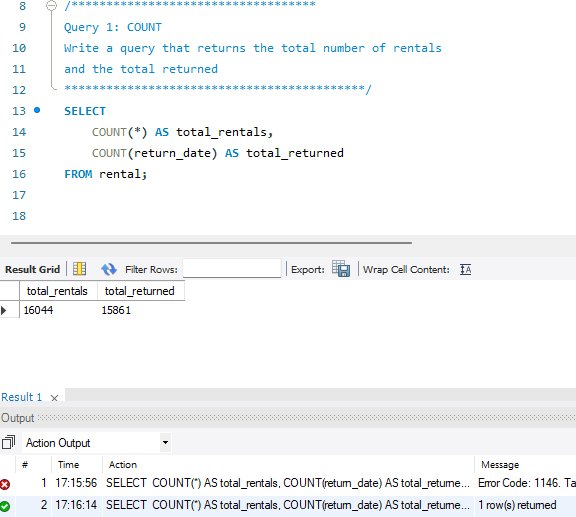
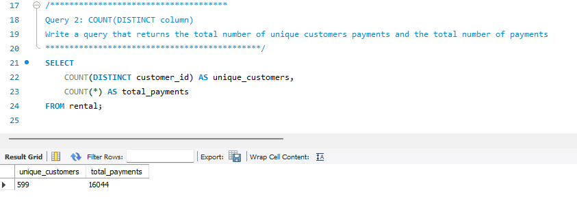
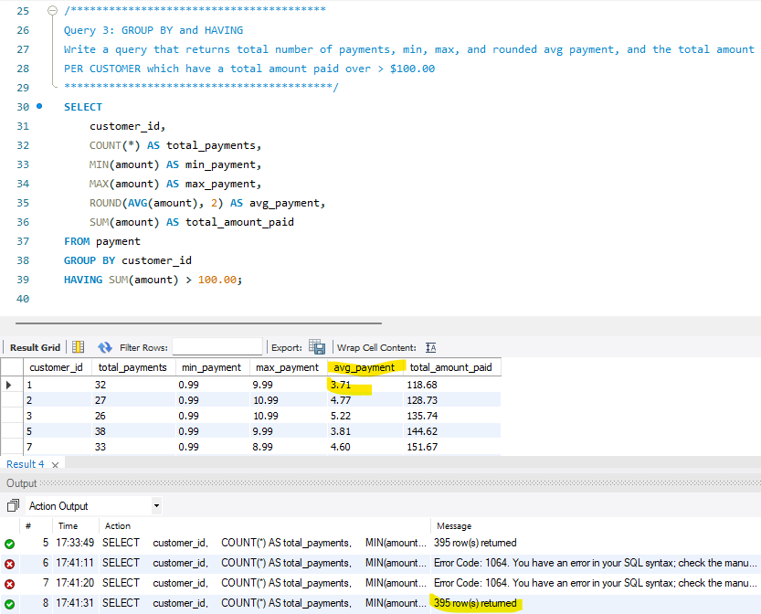
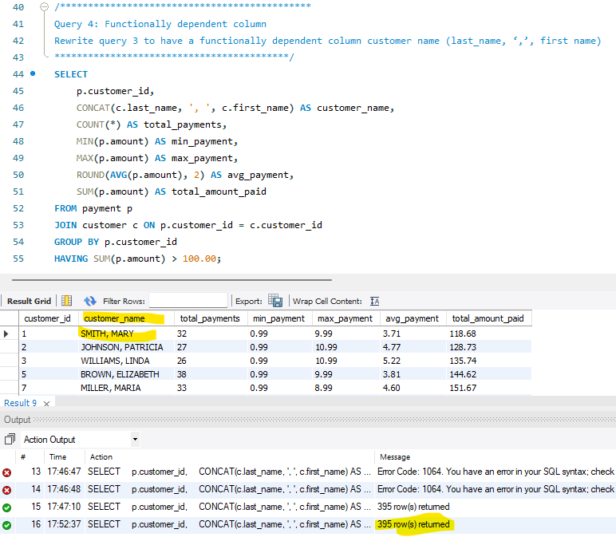
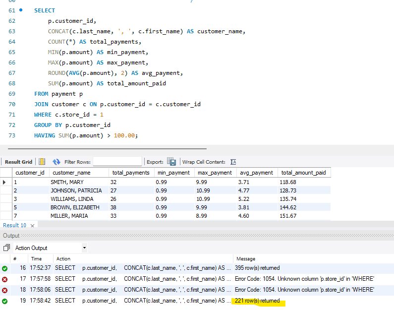
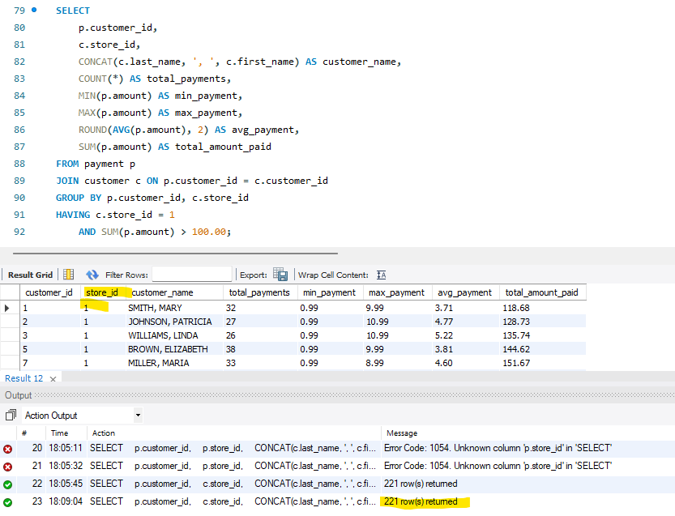
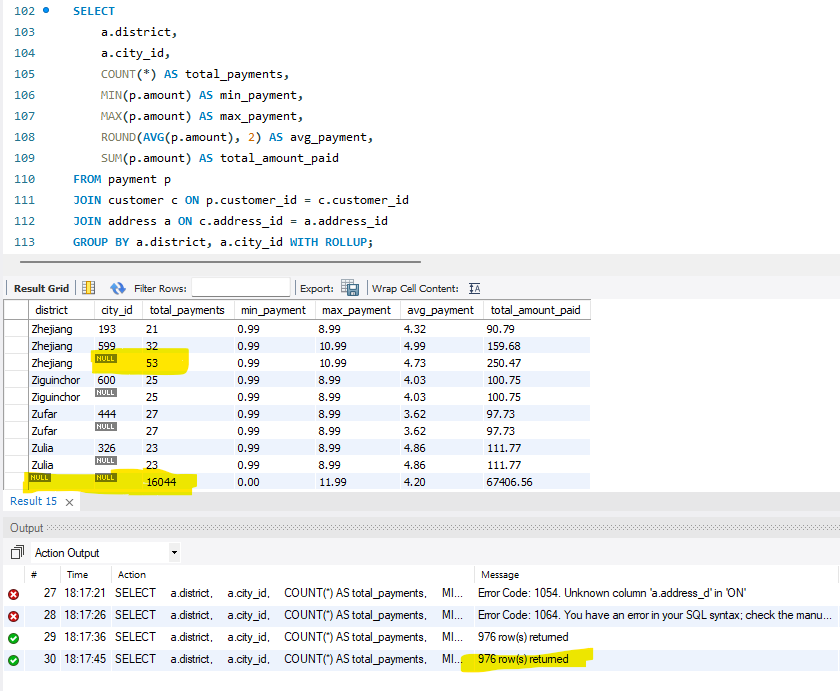
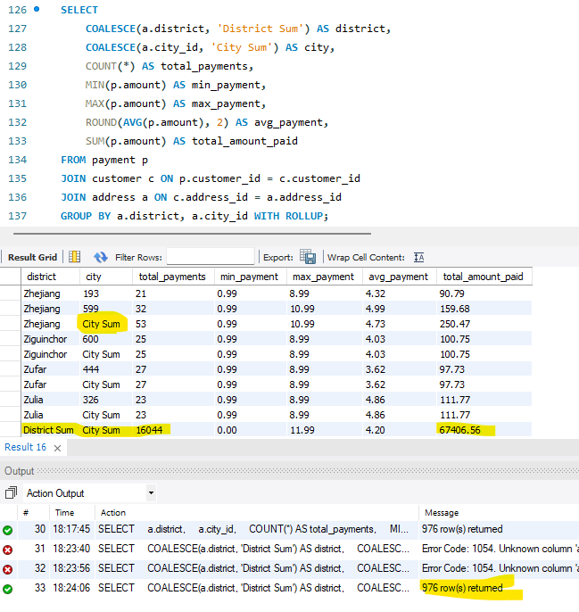

# Chapter6
Table of Content

Summary
Workers
New Concepts Used
Browser Output Example
Summary
Retrieving data from multiple tables

Workers
@jacobczapla Jacob Czapla

New Concepts Used
- Count
- Count(DISTINCT column)
- GROUP BY and Having
- Functionally dependent column
- WHERE vs HAVING
- ROLLUP
- GROUPING and COALESCE functions
- 

Query 1

Query 2

Query 3

Query 4

Query 5

Query 6

Query 7

Query 8

